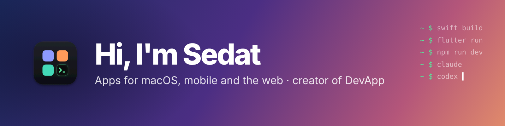

  

I build apps for **macOS, mobile and the web**, and lately tools that make working with AI coding agents a lot less chaotic.

- 🛠️ Building **[DevApp](https://github.com/gulmensedat/devapp)**, a native macOS app for running projects, terminals and AI agents from one window
- 🤖 Daily driver: Claude Code and Codex
- 💬 Happy to chat on [LinkedIn](https://www.linkedin.com/in/sedatgulmen)

## Featured project

**[DevApp](https://github.com/gulmensedat/devapp)** · one window for every project, terminal and AI agent on your Mac.
One-click dev servers with smart ports, Claude & Codex side by side in their own git worktrees, a Dock menu for every open terminal and desktop widgets for usage limits. SwiftUI · open source · MIT.

## Contributions

<picture>
  <source media="(prefers-color-scheme: dark)" srcset="https://raw.githubusercontent.com/gulmensedat/gulmensedat/output/snake-dark.svg">
  <source media="(prefers-color-scheme: light)" srcset="https://raw.githubusercontent.com/gulmensedat/gulmensedat/output/snake-light.svg">
  
</picture>

## Tech I work with

  
  
  
  
  
  
  
  
  
  

**AI coding agents**

  
  

## Connect

